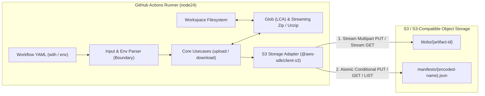

# S3 Artifact GitHub Action 全体アーキテクチャ設計（確定版）

## 1. ゴールと確定スコープ

`actions/upload-artifact`（v7）および `actions/download-artifact`（v8）とドロップイン互換の入力・出力を持ち、AWS S3 および S3互換ストレージ（Cloudflare R2, MinIO, GCS, Ceph RGW, Tigris, LocalStack 等）へアーティファクトを保存・取得する OSS GitHub Action を構築する。

### 確定した設計判断（Operator Accepted: 2026-11-25）

| 項目 | 確定方針 |
|---|---|
| **公開構成・リポジトリ名** | サブディレクトリ型（`upload/action.yml`, `download/action.yml`）のみを提供し、ルート `action.yml` は置かない（`tfaction` 方式）。リポジトリ名は `s3-artifact` 等の汎用名への変更を前提とする。 |
| **v1 互換スコープ** | ① コア互換一式（複数 `path`/glob、`if-no-files-found`、`compression-level`、`overwrite`、`include-hidden-files`、`pattern`、`merge-multiple`、`digest-mismatch`）<br>② 単一ファイル無圧縮転送・未展開取得（`archive: false`, `skip-decompress: true`）<br>③ 別Run・別リポジトリ・ID指定取得（`run-id`, `repository`, `artifact-ids`）<br>※ サブアクション `merge` は v1 スコープ外とする。 |
| **`retention-days` の扱い** | Manifest JSON の `expiresAt` に記録（取得時に期限切れを除外）しつつ、Blob と Manifest の双方に S3 Object Tag（`s3-artifact-retention-days=<N>`）を付与する。物理削除はバケット側の S3 Lifecycle ルールに委譲し、`s3:PutObjectTagging` 権限不足やタグ非対応のS3互換ストアでは `warning` を出してアップロード自体は継続する。 |
| **`artifact-url` の扱い** | `s3://<bucket>/<blobKey>` 形式の URI を出力する。 |
| **実装・配布・リリース** | TypeScript（`node24` + `esbuild` 単一ファイルバンドル + AWS SDK v3）で `dist/` をリポジトリにコミットし、`tagpr` でリリース作成およびメジャータグ `v1` の自動更新を行う。 |

---

## 2. システム境界と全体フロー



システム境界は3箇所に集約し、内部ユースケースは純粋なドメイン型のみを扱う。

1. **Action 入力・環境変数境界 (`src/shared/inputs.ts`)**: `action.yml` の `inputs` と `process.env` をパースし、不正値（`compression-level` 範囲外、`name` と `artifact-ids` の同時指定、NTFS禁止文字を含むアーティファクト名など）を境界で即座に拒否する。
2. **ファイルシステム・アーカイブ境界 (`src/core/search.ts`, `src/core/archive.ts`)**: `@actions/glob` による探索・最小共通祖先（LCA）算出、シンボリックリンク実体解決、ZIPストリーム生成、および展開時の **Zip-Slip（パストラバーサル）検査** を担う。
3. **S3 ストレージ境界 (`src/storage/s3-store.ts`)**: AWS SDK v3 による Multipart Upload、Conditional Write（`If-None-Match` / `If-Match`）、Object Tagging、S3互換ストア向けチェックサム制御を隠蔽する。

---

## 3. S3 オブジェクト設計（2案比較と採用構造）

### 不採用案（Shape A）: Blob単体 + `x-amz-meta-*` ヘッダ方式
`{prefix}/{owner}/{repo}/runs/{run_id}/{name}.zip` の単一オブジェクトのヘッダにメタデータを持たせる方式。
- `CreateMultipartUpload` はストリーム開始前にヘッダを確定させるため、圧縮後の `size` と `sha256` をヘッダに入れるにはローカルディスクへの全量一時書き出しが必要になる。
- `ListObjectsV2` が `x-amz-meta-*` を返さないため、`pattern` や全件取得時に N+1 回の `HeadObject` が発生する。

### 採用案（Shape B）: 2フェーズ Blob + アーティファクト単位 Manifest JSON 方式

ラン全体の単一 `index.json`（並列ジョブ間で競合する共有状態）は作らず、アーティファクト名ごとに独立した Manifest JSON をコミット証跡とする。

```text
s3://<bucket>/<key-prefix>/
└── <owner>/<repo>/runs/<run_id>/
    ├── blobs/
    │   └── <artifact_id>                     # 実体（.zip または archive:false の生ファイル）
    └── manifests/
        └── <url_encoded_artifact_name>.json  # 約300Bのメタデータ兼アトミックコミット点
```

1. **一時ファイルゼロの完全ストリーミング**: `archiver`（または生ファイル）→ `HashCountTransform` → S3 Multipart Upload (`blobs/<artifact_id>`) へ直結し、全パート完了後に確定した `sha256` と `size` を持つ `manifests/<name>.json` を `PutObject` する。途中クラッシュ時は未参照の `blobs/` が残るだけで、壊れたアーティファクトが `download` に露出しない。
2. **ロック不要の並列安全性**: マトリクスジョブが別名アーティファクトを同時アップロードしても `manifests/<name>.json` のキーが分離されており競合しない。
3. **原子的な `overwrite: false` と「Re-run failed jobs」の両立**:
   - 「失敗ジョブのみ再実行」で未再実行の上流ジョブの成果物を参照できるよう、S3プレフィックスは `<run_id>` 単位とする。
   - Manifest に `runAttempt`（`GITHUB_RUN_ATTEMPT`）を記録する。`overwrite: false` の場合、**同一 `runAttempt` 内の同名重複は事前検査＋`If-None-Match: "*"` で確実にエラーにし、再実行（`existing.runAttempt < currentRunAttempt`）では `If-Match: <etag>` で安全に差し替える**。

---

## 4. コア型・シグネチャ・モジュール境界

```ts
// src/shared/types.ts
export type BucketName = string & { readonly __brand: 'BucketName' }
export type ArtifactId = string & { readonly __brand: 'ArtifactId' } // 53-bit safe integer string
export type ArtifactName = string & { readonly __brand: 'ArtifactName' }
export type Sha256Digest = `sha256:${string}`

export interface RunScope {
  readonly repositoryOwner: string
  readonly repositoryName: string
  readonly runId: number
  readonly runAttempt: number
}

export interface S3BackendConfig {
  readonly bucket: BucketName
  readonly keyPrefix: string
  readonly region: string
  readonly endpoint?: string
  readonly forcePathStyle: boolean
  readonly credentials?: {
    readonly accessKeyId: string
    readonly secretAccessKey: string
    readonly sessionToken?: string
  }
}

export interface ArtifactManifestV1 {
  readonly schemaVersion: 1
  readonly id: ArtifactId
  readonly name: ArtifactName
  readonly repository: `${string}/${string}`
  readonly runId: number
  readonly runAttempt: number
  readonly blobKey: string
  readonly size: number
  readonly digest: Sha256Digest
  readonly archived: boolean
  readonly rawFileName: string
  readonly contentType: string
  readonly retentionDays?: number
  readonly createdAt: string
  readonly expiresAt?: string
}

export type WriteGuard =
  | { readonly mode: 'create-only' }
  | { readonly mode: 'compare-and-swap'; readonly etag: string }
  | { readonly mode: 'unconditional' }

// src/storage/store.ts
export interface PutBlobOptions {
  readonly scope: RunScope
  readonly id: ArtifactId
  readonly body: NodeJS.ReadableStream
  readonly contentType: string
  readonly retentionDays?: number
}

export interface ManifestLookupResult {
  readonly manifest: ArtifactManifestV1
  readonly etag?: string
  readonly expired: boolean
}

export interface ArtifactStore {
  getManifestWithMeta(
    scope: RunScope,
    name: ArtifactName
  ): Promise<ManifestLookupResult | null>
  putBlobStream(
    opts: PutBlobOptions
  ): Promise<{ readonly blobKey: string; readonly size: number; readonly digest: Sha256Digest; readonly artifactUrl: string }>
  commitManifest(
    scope: RunScope,
    manifest: ArtifactManifestV1,
    guard: WriteGuard
  ): Promise<void>
  listManifests(scope: RunScope): Promise<ArtifactManifestV1[]>
  openBlobStream(blobKey: string): Promise<NodeJS.ReadableStream>
  deleteBlobBestEffort(blobKey: string): Promise<void>
}
```

---

## 5. S3設定インターフェースとS3互換対策

ワークフロー先頭の `env:` にバケット設定を1回書けば、各ステップは公式 `actions/upload-artifact` と同じ `with:` のまま動作する。

| `action.yml` input | フォールバック環境変数（優先順） | デフォルト / 挙動 |
|---|---|---|
| `bucket` | `S3_ARTIFACT_BUCKET` | **必須** |
| `key-prefix` | `S3_ARTIFACT_KEY_PREFIX` | `""`（先頭・末尾の `/` は正規化） |
| `region` | `S3_ARTIFACT_REGION`, `AWS_REGION`, `AWS_DEFAULT_REGION` | `endpoint` 指定時は `"auto"`、未指定時は `"us-east-1"` フォールバック |
| `endpoint` | `S3_ARTIFACT_ENDPOINT`, `AWS_ENDPOINT_URL_S3`, `AWS_ENDPOINT_URL` | 未指定時は AWS 標準エンドポイント |
| `force-path-style` | `S3_ARTIFACT_FORCE_PATH_STYLE` | `false`（MinIO / LocalStack 等で必要に応じ `true`） |
| `access-key-id` / `secret-access-key` / `session-token` | 標準 `AWS_*` クレデンシャルチェーン（OIDC / IAM Role 対応） | input 指定時は自動で `core.setSecret()` を適用 |

- **AWS SDK v3 デフォルトCRC32トレーラ抑止**: `S3Client` に `requestChecksumCalculation: 'WHEN_REQUIRED'`, `responseChecksumValidation: 'WHEN_REQUIRED'` を指定し、Cloudflare R2 / MinIO / GCS S3互換APIでの互換性破壊を防ぐ。
- **Tagging フォールバック（Accepted Update: Lead Review 2026-11-25）**: ワンショットの ZIP ストリームをタグ拒否で消費させないため、Blob は先にストリーム転送を完了させた後に `PutObjectTaggingCommand` で `s3-artifact-retention-days=<N>` を付与し、Manifest は `PutObjectCommand` の `Tagging` 失敗時にタグ無しで再試行のうえ `core.warning` を出力する。また S3 上に物理残存している期限切れ Manifest を `overwrite: false` で再アップロードする際は、`If-None-Match: "*"` の物理衝突を避けるため `ManifestLookupResult.expired` に基づき `If-Match`（`compare-and-swap`）で安全に置換する。
- **ダウンロード時の定数メモリ展開（Accepted Update: Lead Review 2026-11-25）**: 巨大 ZIP（数GB超）でランナーメモリを圧迫しないよう、ダウンロードストリームは SHA-256 を計算しながら `os.tmpdir()` の一時ファイルへスプールし、ダイジェスト検証通過後に `yauzl.open` で展開する。

---

## 6. ディレクトリ構成

```text
.
├── upload/
│   └── action.yml              # runs: node24, main: '../dist/upload/index.js'
├── download/
│   └── action.yml              # runs: node24, main: '../dist/download/index.js'
├── src/
│   ├── shared/
│   │   ├── types.ts            # ドメイン型・Manifest V1 スキーマ
│   │   ├── errors.ts           # ドメインエラー型
│   │   ├── validation.ts       # アーティファクト名・NTFS禁止文字・パス検証
│   │   ├── s3-config.ts        # S3 input / env パーサ
│   │   └── ids.ts              # 53-bit 安全整数 ArtifactId 生成
│   ├── core/
│   │   ├── search.ts           # @actions/glob + 複数パス LCA ルート算出
│   │   ├── archive-zip.ts      # archiver ストリーミングZIP生成（symlink実体化対応）
│   │   ├── extract-zip.ts      # Zip-Slip防止付き一時スプール展開 + SHA-256検証
│   │   ├── hash-stream.ts      # 通過バイト数 + SHA-256 算出 Transform ストリーム
│   │   └── mime-types.ts       # Content-Type 判定
│   ├── storage/
│   │   ├── store.ts            # ArtifactStore インターフェース + キー生成規則
│   │   ├── s3-store.ts         # AWS SDK v3 S3実装（Multipart / Conditional PUT / Tagging fallback）
│   │   └── memory-store.ts     # 高速テスト用インメモリ実装（ETag / If-None-Match 忠実再現）
│   ├── upload/
│   │   ├── inputs.ts           # upload 固有 input パーサ
│   │   ├── run-upload.ts       # upload ユースケース本体
│   │   ├── action.ts           # upload 境界ランナー
│   │   └── index.ts            # Actions エントリポイント
│   └── download/
│       ├── inputs.ts           # download 固有 input パーサ
│       ├── run-download.ts     # download ユースケース本体（並列チャンク取得・digest検証）
│       ├── action.ts           # download 境界ランナー
│       └── index.ts            # Actions エントリポイント
├── dist/
│   ├── package.json            # {"type": "commonjs"} (ESM root からの CJS バンドル境界)
│   ├── upload/index.js
│   └── download/index.js
├── __tests__/
│   ├── helpers/                # Action 境界テストハーネス
│   ├── unit/                   # 境界パース・LCA・Zip-Slip・競合/再実行・期限切れの単体テスト
│   └── integration/            # 実S3互換サーバー（cgr.dev/chainguard/minio）に対する結合テスト
├── scripts/
│   └── build.mjs               # esbuild バンドルスクリプト
├── .github/
│   ├── workflows/
│   │   ├── ci.yml              # lint / typecheck / vitest / dist差分検査 / MinIOサービスE2E(./upload -> ./download)
│   │   └── tagpr.yml           # tagpr リリース自動化 + メジャータグ v1 更新
│   ├── release.yml             # リリースノート自動分類設定
│   └── tagpr                   # tagpr 設定ファイル
├── package.json
├── tsconfig.json
└── README.md
```

---

## 7. 実装フェーズ計画（段階的・検証可能な分割）

実装に進む際は、各フェーズが単独でビルド・検証可能な単位（PRまたは論理コミット列）として順番に進める。

- [ ] **Phase 1: プロジェクト基盤とドメイン境界・ストレージ層**
  - TypeScript / Vitest / ESLint / `esbuild` 構成の初期化
  - `src/shared/*`（型・Manifestスキーマ・バリデーション・S3設定パーサ）と `src/storage/*`（`S3ArtifactStore` / `InMemoryArtifactStore`）の実装と単体テスト
- [ ] **Phase 2: ファイル探索・ストリーミングZIP生成/展開コア**
  - `src/core/*`（`@actions/glob` LCA探索、`archiver` ストリーミングZIP、Zip-Slip防御付き展開、SHA-256計測ストリーム）の実装とエッジケース（隠しファイル、シンボリックリンク、単一生ファイル、破損ダイジェスト）テスト
- [ ] **Phase 3: `upload` / `download` ユースケース・`action.yml`・`dist/` バンドル**
  - `upload/action.yml`, `download/action.yml`, `src/upload/*`, `src/download/*` の実装
  - `esbuild` バンドル生成と、ローカルS3互換サーバーに対する実プロセス E2E 検証（`node dist/upload/index.js` → `node dist/download/index.js`）
- [ ] **Phase 4: GitHub Actions CI（MinIO E2E）・`tagpr` リリース設定・ドキュメント**
  - `.github/workflows/ci.yml`（`services: minio` を使った `uses: ./upload` → `uses: ./download` 実ワークフローE2E + `dist/` 差分チェック）
  - `.github/workflows/tagpr.yml` + `.github/tagpr`（リリース時に `v1` タグも追従更新）と `README.md`（移行ガイド・IAM最小権限ポリシー例・R2/MinIO設定例・Lifecycleルール例）
